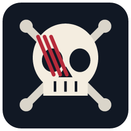

# 🏴‍☠️ GhostManga — Ultra-Fast Native C++20 Desktop Manga Reader & AMR Port

<p align="center">
  
</p>

<p align="center">
  <a href="https://github.com/geataa/GhostManga/releases/tag/v1.0.0"></a>
  <a href="https://github.com/geataa/GhostManga/releases/download/v1.0.0/GhostManga.exe"></a>
</p>

<p align="center">
  <a href="LICENSE"></a>
  
  
  
  
  
  
  
</p>

**GhostManga** is the native Windows desktop counterpart to **All Mangas Reader (AMR)** — written from scratch in pure **C++20** with hardware-accelerated **Direct3D 11 / Direct2D / DirectComposition** rendering. Shipped as a **single ~4.7 MB portable executable (`GhostManga.exe`)** with zero external DLLs, it imports your entire AMR reading list in one click, tracks chapters in the background across **236 embedded manga sources**, reads online or offline (`.cbz` / `.zip` / folders), and bypasses anti-bot challenges seamlessly while blocking intrusive ad popups.

---

## 📥 Download v1.0.0 (Ready-to-Run Portable `.exe`)

No installer, no external DLLs, no runtime bloat. Download `GhostManga.exe`, place it anywhere, and run:

- 👉 **[Download `GhostManga.exe` (v1.0.0 Standalone Portable Executable)](https://github.com/geataa/GhostManga/releases/download/v1.0.0/GhostManga.exe)**
- 📦 **[View v1.0.0 Release Page & Release Notes](https://github.com/geataa/GhostManga/releases/tag/v1.0.0)**

All user data, reading progress, caches, and logs are stored cleanly inside the `portable_data/` folder next to `GhostManga.exe`.

---

## 🌟 Key Highlights & Product Features

### 1. ⚡ Pure Native C++20 Single-EXE Architecture
- **Zero Bloat**: No Electron, no Qt, no Node.js runtime. Pure Win32 + Direct3D 11 + Direct2D + DirectWrite + WIC.
- **Truly Self-Contained**: Statically linked (`/MT`) with **QuickJS-ng** (C11 JS engine), **Lexbor** (fast HTML5/CSS selector parser), **Miniz** (archive reader/writer), **236 AMR mirror scripts**, and **15 language packs** embedded directly inside `GhostManga.exe`.
- **Zero Registry Pollution**: Leaves the Windows Registry untouched (with an optional Startup shortcut in the User Startup folder when enabled).

### 2. 🔍 Global Multi-Source Manga Search (AMR Style)
- **Native Endpoint Search (No Full-Site Crawling)**: Queries each mirror's native search endpoint/API directly (`GET /search?q=...`, `POST admin-ajax.php`, or REST API) with `preventimages: true`, returning fast results without hammering servers or risking IP bans.
- **Smart Grouping & Relevance Ranking**: Groups identical series across multiple mirrors into a single card sorted by exact/prefix match and relevance score.
- **One-Click Add & Status Badges**: Sources already in your library show a **`✓`** badge; new sources show a **`+`** button to add them immediately to your reading list.
- **Up to 5 Concurrent Search Tabs**: Each search tab preserves its own query, results, selected mirror, and scroll position with instant cancellation support.

### 3. 📖 Hardware-Accelerated Manga Reader & Thumbnail Film Strip
- **Multiple Reading Modes**: Continuous vertical **Webtoon** strip (with seamless spacing), **Double-Page** spread (with standalone cover option), **Single-Page**, and **RTL / LTR** direction toggle.
- **Bottom Thumbnail Strip**: Interactive film-strip preview bar at the bottom displaying page thumbnails in sequence for instant page jumping.
- **Smart Navigation**: Automatically hides the *"Next Chapter"* button when you are reading the latest available chapter; chapter selector dropdown automatically opens scrolled to your current reading position.
- **Interactive Scrollbar & HUD**: Draggable right-hand position bar, zoom controls (`+` / `-` / `0`), background brightness dimmer (`[` / `]`), and toggleable side drawer (`M` / `C`).

### 4. 📚 Rich Library Management & Safety Controls
- **1-Click AMR Import & Export (`Ctrl+I` or Drag & Drop)**: Supports AMR V2, legacy AMR V1, and share exports. Automatically backs up `library.json` to `library.json.bak` using atomic temp-file replacement (`MoveFileExW`) so data is never lost on crash or power loss.
- **Cards & List Views with Color-Coded Status**:
  - 🔵 **Blue tint**: Read up to the latest known chapter.
  - 🟡 **Yellow tint**: Unread chapters available!
  - 🔴 **Red tint & warning badge**: Source update error (hover/inspect for detailed diagnostics without overriding healthy grouped sources).
- **Series Detail Modal**: Click any card to inspect chapters, filter *All / Unread / Read*, search chapter numbers, **Mark Read up to Latest Chapter**, **Reset Reading Progress**, remove individual mirror sources, or delete the entire series group.
- **Double-Confirmation Library Reset**: Full library reset asks *"Are you sure?"* twice to prevent accidental data loss.

### 5. 🛡️ Two-Carrier Single-Session (2T1O) & Smart Ad-Popup Blocker
- **Fast Primary Lane + WebView2 Tandem Fallback**: Uses native WinHTTP for speed and automatically falls back to an embedded Evergreen WebView2 session when Cloudflare Turnstile / JS challenges are detected, sharing clearance cookies (`cf_clearance`) back to the native CookieJar.
- **Smart Popup & Ad Blocker**: Distinguishes real human-verification / bot challenges (*"Are you human?"* / Cloudflare Turnstile) from ad/redirect spam — silently blocking unwanted ad popups that try to flash open and close.

### 6. 💾 Offline `.CBZ` Downloads, Local Library & Recycle Bin Safety
- **One-Click Offline Download**: Save any chapter as a standard `.cbz` archive (written atomically) or raw image folder with `.ghostmanga.json` metadata.
- **Local Folders Browser**: Automatically indexes downloaded `.cbz`/`.zip` archives and cached chapters with cover previews, sorting, and deduplication.
- **Safe Deletion**: Deleting local chapters shows the full path, asks for confirmation, and moves files safely to the **Windows Recycle Bin** (`SHFileOperationW`).

### 7. 🌐 15 Built-in Interface Languages
Instant runtime switching (`L` shortcut or **Settings → Appearance**) across **15 embedded languages**:
`English` · `German` · `French` · `Spanish` · `Italian` · `Portuguese` · `Russian` · `Polish` · `Dutch` · `Japanese` · `Korean` · `Simplified Chinese` · `Indonesian` · `Azerbaijani` · `Turkish`

---

## ⌨️ Keyboard Shortcuts

| Shortcut | Action |
| :--- | :--- |
| `←` / `→` | Previous / Next Page (respects RTL/LTR) |
| `,` / `.` | Previous / Next Chapter |
| `W` | Toggle Webtoon (Continuous Vertical Strip) Mode |
| `B` | Toggle Double-Page Spread Mode |
| `R` | Toggle Reading Direction (RTL / LTR) |
| `M` | Open / Close Reader Side Menu |
| `C` | Open Reader Side Menu & Focus Chapter List |
| `+` / `-` / `0` | Zoom In / Zoom Out / Reset Zoom |
| `[` / `]` | Adjust Background Darkness |
| `F11` | Toggle Fullscreen |
| `Ctrl+O` | Open Local Manga Folder / `.cbz` / `.zip` Archive |
| `Ctrl+I` | Import AMR Backup JSON |
| `L` | Cycle Interface Language (15 Languages) |
| `H` | Toggle Shortcuts Help Overlay |
| `Esc` | Go Back / Close Modal / Cancel Dialog |

---

## ⚡ Technical Architecture

| Layer | Technology & Implementation |
| :--- | :--- |
| **Language & Standard** | ISO C++20 (`/std:c++20`, `/O2`, `/GL`, `/MT`, MSVC 2022) & C11 |
| **Graphics & UI Shell** | Native Win32, Direct3D 11, Direct2D, DirectComposition, DirectWrite, WIC (`GhostView` immediate-mode UI) |
| **Embedded JS Runtime** | QuickJS-ng (C11 amalgamated build with 512 KB recursion guard & custom DOM/Fetch bridge) |
| **HTML5 / CSS Parser** | Lexbor Static HTML5 & CSS Selectors Engine (`lexbor_static.lib`) |
| **Network & Anti-Bot** | WinHTTP (TLS 1.2/1.3) + Evergreen WebView2 Tandem Bridge (`2T1O` shared `CookieJar`) |
| **Archive Engine** | Miniz ZIP/CBZ reader & atomic writer with 256 MB decompression bomb guard |
| **Persistence** | Portable JSON (`portable_data/library.json` with `.bak` atomic failover & `settings.ini`) |

---

## 🛠️ Building from Source & Running Tests

### Prerequisites
- **OS**: Windows 10 (1809+) or Windows 11 (x64)
- **Compiler**: Visual Studio 2022 (Community, Professional, Enterprise, or Build Tools) with C++ Desktop Development workload

### Build with One Command
All third-party headers and static libraries (`QuickJS-ng`, `Lexbor`, `Miniz`, `WebView2LoaderStatic.lib`) are vendored in `third_party/`. Simply run:

```bat
build.bat
```

This compiles and links the standalone executable to `bin\GhostManga.exe` and copies it to `GhostManga.exe`.

To clean all build artifacts:
```bat
build.bat clean
```

### Automated Test Suites
GhostManga includes unit, regression, UI, and source health test suites under `tests/`:

```bat
tests\run_review.bat
tests\run_library_regressions.bat
tests\run_ui_review.bat
tests\run_text_input.bat
```

---

## 🤖 100% Vibe Coding

This project embraces the future of software engineering: **GhostManga v1.0.0 was built 100% through Vibe Coding** orchestrated by **[@geataa](https://github.com/geataa)**:

- 🎯 **Human Vision, Product Direction & Live QA**: System architecture design, UX conception, performance specifications, and real-world validation by **[@geataa](https://github.com/geataa)**.
- 🚀 **AI Agentic Execution (Antigravity, Claude & Codex)**: End-to-end C++20 native code synthesis, Win32 message loop design, Direct2D rendering pipelines, QuickJS-ng + Lexbor mirror engine integration, WebView2 anti-bot bridge, and multi-threaded synchronization.
- ✅ **Zero Hallucination Standard**: 100% verified with deterministic automated test suites and live execution benchmarks.

We believe in radical transparency: AI-assisted development empowers solo creators to deliver robust, industrial-grade native applications at breakneck speed.

---

## 🎮 Also From SkySoftwareStudios / geataa on Steam

> By day, I work full-time as a software engineer. Evenings and weekends are dedicated to my passion for indie game development. In the spare moments left over from crafting games, I build tailored, high-performance native tools like **GhostManga** and **[Gety](https://github.com/geataa/Gety)** through modern **vibe coding** with AI.
> 
> When I'm not writing native tools, check out the game worlds I'm bringing to life on Steam:

<div align="center">

### 🧗 [BouncyClimb](https://store.steampowered.com/app/4787630/)
*A high-octane, physics-defying multiplayer climbing and platforming adventure! Race against your friends, scale hazardous heights, and master the bounce.*

[](https://store.steampowered.com/app/4787630/)

---

### 🍸 [Neon Angora](https://store.steampowered.com/app/4447940/)
*A groundbreaking social simulation and nightclub roleplaying experience powered by Local LLM AI. No canned dialogue trees—speak your mind, influence dynamic NPCs, uncover secrets, and experience a living story that reacts to who you choose to be.*

[](https://store.steampowered.com/app/4447940/)

</div>

---

## 📄 License

GhostManga is licensed under the **[MIT License](LICENSE)**.

You are free to use, modify, distribute, and incorporate GhostManga into private and commercial projects under the terms of the MIT License.

---

<p align="center">
  Crafted with ❤️, Pure C++20, and 100% Vibe Coding by <b>SkySoftwareStudios / SkySoft (geataa)</b>.
</p>
